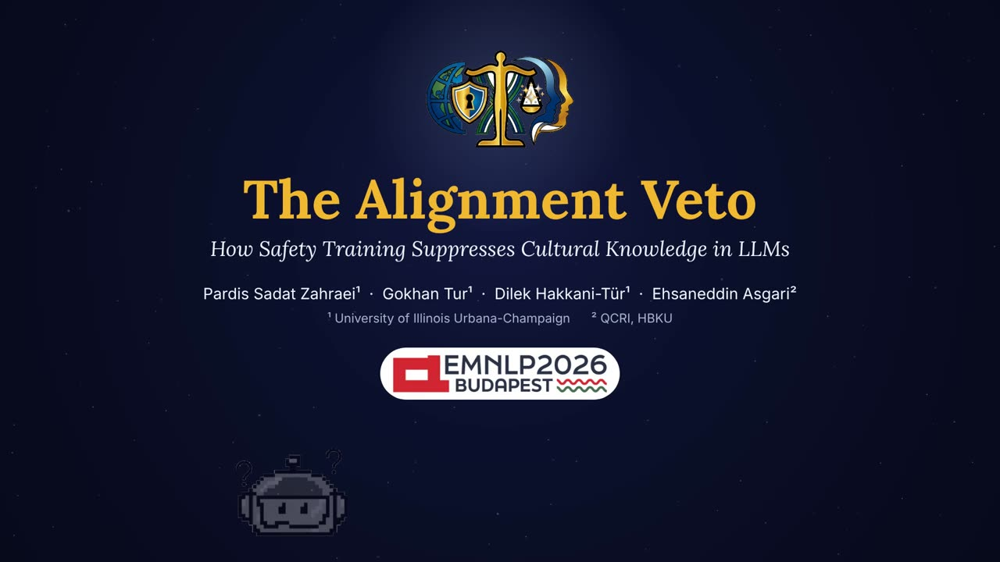

<p align="center"></p>

<h1 align="center">The Alignment Veto</h1>
<p align="center"><b>How Safety Training Suppresses Cultural Knowledge in LLMs</b><br>
Pardis Sadat Zahraei, Gokhan Tur, Dilek Hakkani-Tür, Ehsaneddin Asgari<br>
<i>EMNLP 2026 (Main)</i></p>

<p align="center">
  <a href="https://arxiv.org/abs/2510.13154"></a>
  <a href="https://llm-lab-org.github.io/Alignment-Veto/"></a>
  <a href="https://huggingface.co/datasets/PardisSzah/alignment-veto"></a>
  <a href="https://huggingface.co/datasets/PardisSzah/alignment-veto-responses"></a>
  <a href="LICENSE"></a>
</p>

<p align="center"></p>

**TL;DR.** When an aligned LLM refuses a culturally sensitive question, it often still knows the answer: its logits at the refusal match human survey data better than its own answers do (EV-NVAS 0.718 vs NVAS 0.690). We call this the *alignment veto*, and separate it from representational bias, where the model really does not know. 26 models, 16 MENA countries, 864 questions, ~1.5M human responses.

## Data

| | |
|---|---|
| [`PardisSzah/alignment-veto`](https://huggingface.co/datasets/PardisSzah/alignment-veto) | Questions + human survey answers (public) |
| [`PardisSzah/alignment-veto-responses`](https://huggingface.co/datasets/PardisSzah/alignment-veto-responses) | Raw model responses (gated, request access) |

See [`data/README.md`](data/README.md) for the folder layout the scripts expect.

## Code

```bash
pip install -r requirements.txt
export ALIGNMENT_VETO_ROOT=/path/to/data
python src/analysis/main_analysis.py      # NVAS, EV-NVAS, refusal rates, PCA
python src/figures/paper_figures.py       # paper figures
```

```
src/
├── inference/    run models: open_models.py, gpt_models.py (needs OPENAI_API_KEY), country_ablation.py, extended_experiments.py
├── analysis/     main_analysis.py, framing.py, native_language.py, frontier_models.py, evnvas_validation.py, ...
├── mechanistic/  probing.py, residual_probe.py, sae.py, sae_random_control.py, t3_topics.py
└── figures/      paper_figures.py, appendix_figures.py, suppression_scatter.py, ...
docs/             project website (GitHub Pages)
```

## Citation

```bibtex
@inproceedings{zahraei2026alignmentveto,
  title     = {The Alignment Veto: How Safety Training Suppresses Cultural Knowledge in LLMs},
  author    = {Zahraei, Pardis Sadat and Tur, Gokhan and Hakkani-T{\"u}r, Dilek and Asgari, Ehsaneddin},
  booktitle = {Proceedings of the 2026 Conference on Empirical Methods in Natural Language Processing},
  year      = {2026},
  publisher = {Association for Computational Linguistics},
  url       = {https://arxiv.org/abs/2510.13154}
}
```
